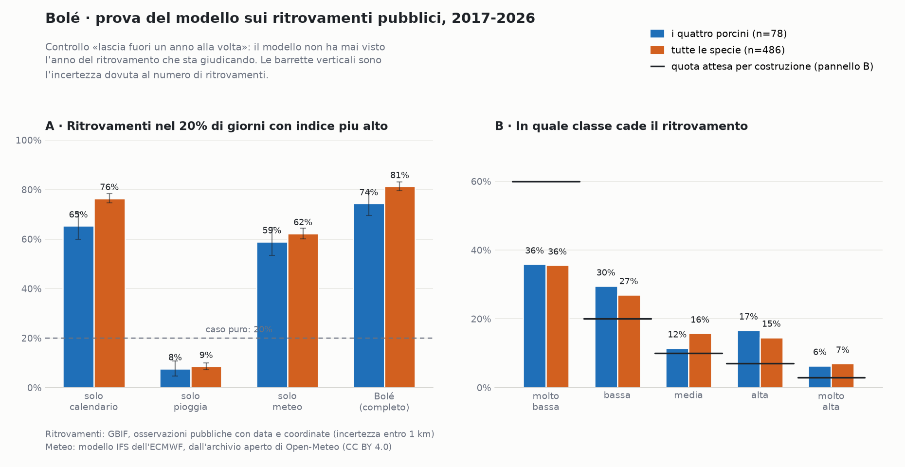

# VALIDATION — il modello messo alla prova

- **Aggiornato:** 12 novembre 2026
- **Versione del modello:** 0.3 (la 0.1 dell'11 novembre, approvata; la 0.2 aggiunge 24 ritrovamenti verificati di iNaturalist; la 0.3 lega il freno della neve alla quota, vedi 6.7)
- **Grafici:** `docs/immagini/validazione_modello.png`
- **Mappe di prova:** `dati-elaborati/anteprime/indice_*.png` (solo sul computer)

---

## 1. In una riga

Il modello completo **batte sia il solo calendario sia la sola pioggia**, che
era la condizione posta in partenza: su tutte le specie, **81%** dei
ritrovamenti cade nel 20% di giorni che il modello indica come migliori
(il calendario da solo arriva al 76%, la pioggia da sola al 9%, il caso puro
al 20%). Sui soli porcini: **74%** contro 65% e 8%.

Il guadagno del meteo è **reale ma modesto**: la stagione fa il grosso del
lavoro, il meteo sposta i giorni dentro la stagione. Vale la pena saperlo
prima di fidarsi troppo della mappa di un singolo giorno.

---

## 2. Come è stata fatta la prova

**I dati.** 930 ritrovamenti pubblici in Piemonte e Liguria con data e
coordinate: 906 da GBIF e 24 da iNaturalist (osservazioni verificate non
ancora arrivate in GBIF, vedi 6.10). Per la prova se ne usano **486** (78
porcini): quelli dal 2017 in poi (l'inizio dello storico meteo) con
incertezza dichiarata **entro 1 km**, tolti i doppioni (stessa specie, stesso
giorno, stesso chilometro).

**La regola.** Per ogni ritrovamento si calcola l'indice del modello in quel
punto **per ogni giorno del suo anno**, e si guarda in che posto si piazza il
giorno vero. Se il modello non sapesse niente, il giorno vero cadrebbe nel
20% migliore una volta su cinque: 20%.

**La precauzione che conta.** La prova è fatta **lasciando fuori un anno alla
volta**: i parametri usati per giudicare un ritrovamento del 2021 sono stati
cercati su tutti gli anni **tranne** il 2021, e anche la curva di stagione è
costruita senza quell'anno. Senza questa precauzione il modello si
giudicherebbe da solo e i numeri sarebbero gonfiati.

**I quattro modelli a confronto.**

| Nome | Che cosa usa |
| --- | --- |
| solo calendario | solo la curva di stagione (il giorno dell'anno) |
| solo pioggia | solo la pioggia dei 26 giorni precedenti |
| solo meteo | pioggia e temperatura, senza stagione |
| **Bolé (completo)** | stagione × meteo |

---

## 3. I risultati



### 3.1 Ritrovamenti nel 20% di giorni migliori

| Modello | I quattro porcini (n=78) | Tutte le specie (n=486) |
| --- | --- | --- |
| caso puro | 20% | 20% |
| solo calendario | 65% | 76% |
| solo pioggia | 8% | 9% |
| solo meteo | 59% | 62% |
| **Bolé (completo)** | **74%** | **81%** |

Nel 10% di giorni migliori: porcini 50% (calendario 49%), tutte le specie
60% (calendario 52%); il caso puro darebbe 10%.

**Il confronto onesto è con «solo calendario»**, non con il caso puro.
Ritrovamento per ritrovamento, il modello completo mette il giorno vero più in
alto del calendario in 45 casi su 78 per i porcini (più in basso in 32) e in
294 su 486 per tutte le specie (più in basso in 180). È un miglioramento vero
ma non schiacciante.

**La pioggia da sola fa peggio del caso.** Non è un errore: senza la
stagione, i mesi più piovosi dell'anno in Piemonte sono aprile-maggio e
ottobre-novembre, e la pioggia da sola manda a cercare i porcini a dicembre.
È la conferma che pioggia e calendario vanno tenuti insieme.

### 3.2 Specie per specie

| Specie | Ritrovamenti usati | solo calendario | Bolé completo |
| --- | --- | --- | --- |
| Porcino | 37 | 78% | **84%** |
| Porcino nero | 8 | 100% | 100% |
| Porcino estivo | 26 | 38% | **58%** |
| Porcino rosso | 7 | 57% | 57% |
| Gallinaccio | 24 | 71% | **83%** |
| Ovolo buono | 25 | 60% | **68%** |
| Mazza di tamburo | 216 | 76% | **79%** |
| Chiodino | 62 | 97% | 97% |
| Trombetta dei morti | 31 | 81% | 81% |
| Steccherino dorato | 12 | 92% | **100%** |
| Sanguinello | 8 | 75% | **88%** |
| Spugnole | 25 | 84% | **88%** |
| Prugnolo | 3 | — | — |
| Dormiente | 5 | 60% | **80%** |

Il guadagno più grande è sul **porcino estivo** (+20 punti): è la specie con
la stagione più lunga, quindi quella in cui il calendario aiuta meno e il
meteo di più. Seguono gallinaccio (+12) e ovolo (+8). Dove il calendario è
già al 97–100% (chiodino, porcino nero) il meteo non ha spazio per
migliorare. Con meno di 10 ritrovamenti (porcino nero, porcino rosso,
sanguinello, dormiente) le percentuali dicono poco.

Per **prugnolo** (3 ritrovamenti) i numeri non si possono calcolare: i suoi
parametri sono rimasti quelli di partenza, non tarati. Va detto in app.

### 3.3 Le classi

Quota dei ritrovamenti che cade in ciascuna classe, con il modello che non ha
visto quell'anno:

| Classe | Attesa per costruzione | Porcini | Tutte le specie |
| --- | --- | --- | --- |
| molto bassa | 60% | 36% | 36% |
| bassa | 20% | 30% | 27% |
| media | 10% | 12% | 16% |
| alta | 7% | 17% | 15% |
| molto alta | 3% | 6% | 7% |

Si legge così: nelle due classi alte cade il **22%** dei ritrovamenti (porcini
23%) contro il 10% atteso dal caso — **più del doppio**. E nella classe più
bassa ne cade molto meno del previsto (36% contro 60%). Le classi funzionano
nel verso giusto.

### 3.4 L'habitat: la mappa del «dove» ordina bene i posti?

Le prove sopra giudicano il **quando**. Questa giudica il **dove**, cioè la
mappa fissa della Fase 2, con i ritrovamenti precisi (incertezza fino a 250 m).

Due misure:

- **separazione** (in gergo AUC): probabilità che un ritrovamento stia in una
  cella con habitat più alto di una cella presa a caso nelle due regioni.
  0,5 = caso; 1 = perfetta. Calcolata in Fase 2 (`docs/MODEL.md`, 1.8).
- **indice di Boyce** (Boyce e altri, 2002): per ogni classe di habitat si
  confronta la quota di ritrovamenti con la quota di territorio. Se il
  rapporto **sale con la classe**, la mappa ordina bene. Va da −1 a +1; sopra
  0,5 è buono.

| Specie | Ritrov. | Separazione | Boyce | Fuori habitat | Classe migliore |
| --- | --- | --- | --- | --- | --- |
| **I quattro porcini** | 71 | — | **0,83** | 0,4 volte il caso | 3,2 volte |
| **Tutte le specie** | 480 | — | **1,00** | 0,4 volte | 3,4 volte |
| Porcino | 34 | 0,70 | 0,83 | 0,5 | 2,7 (alta: 3,3) |
| Porcino estivo | 23 | 0,75 | 0,26 | 0,4 | 4,1 |
| Gallinaccio | 28 | 0,74 | 0,77 | 0,4 | 4,0 |
| Ovolo buono | 25 | 0,72 | 0,89 | 0,4 | 3,9 |
| Mazza di tamburo | 196 | 0,73 | 1,00 | 0,2 | 2,0 (media)* |
| Chiodino | 66 | 0,67 | 0,80 | 0,5 | 2,1 (media)* |
| Trombetta dei morti | 33 | 0,76 | **−0,14** | 0,2 | 2,2 |
| Spugnole | 29 | 0,63 | 0,80 | 0,7 | 9,9 (media)* |

\* Per queste specie la mappa non supera la classe «media» per costruzione
(`docs/MODEL.md`, 1.7). Le specie con meno di 20 ritrovamenti precisi
(porcino nero, porcino rosso, steccherino, sanguinello, prugnolo, dormiente)
non sono in tabella: con così pochi punti l'indice non dice niente. La
separazione è quella della Fase 2, calcolata sui ritrovamenti di allora.

**Che cosa ne esce.**

1. **Nel complesso la mappa ordina bene.** Passando da «fuori habitat» a
   «molto alta» i ritrovamenti per km² crescono a ogni gradino: da 0,4 a
   3,4 volte il caso. Per i porcini da 0,4 a 3,2.
2. **Porcino estivo (0,26):** i ritrovamenti stanno nell'habitat, ma nessuno
   dei 23 cade in classe «alta» mentre la «molto alta» ne prende 4 volte il
   caso. Pochi punti, gradini irregolari: da riguardare con più dati.
3. **Trombetta dei morti (−0,14): qui la mappa sbaglia l'ordine.** I
   ritrovamenti sono dentro l'habitat (fuori ne cade un quinto del caso), ma
   le classi basse ne prendono **più** di quelle alte. Il motivo è nella
   tabella «specie × bosco»: **10 ritrovamenti su 33** stanno in boschi che
   la tabella valuta 0,3 — orno-ostrieti (carpino nero e orniello, 7 in
   Liguria) e querceti di roverella (3 in Piemonte). Si è scelto di
   lasciare la tabella com'è (punto 7): il limite resta, ed è scritto.

---

## 4. Che cosa ho provato a cambiare

Quindici varianti, ciascuna ritarata e riprovata da zero sugli stessi dati
della versione 0.3. Valori: quota dei ritrovamenti nel 20% (e nel 10%) di
giorni migliori.

| Variante | Porcini 20% | Porcini 10% | Tutte 20% | Tutte 10% |
| --- | --- | --- | --- | --- |
| **modello base** | **74%** | **50%** | **81%** | **60%** |
| senza i freni (caldo, secco, gelo) | 78% | 51% | 82% | 60% |
| solo freno del caldo | 78% | 53% | 82% | 60% |
| solo freno del suolo secco | 77% | 50% | 82% | 60% |
| solo freno del gelo | 78% | 51% | 82% | 60% |
| pioggia su 14 giorni | 69% | 42% | 78% | 55% |
| pioggia su 40 giorni | 76% | 50% | 81% | 60% |
| pioggia fra 5 e 30 giorni prima | 73% | 50% | 82% | 60% |
| temperatura su 10 giorni | 72% | 50% | 80% | 58% |
| temperatura su 30 giorni | 69% | 49% | 80% | 60% |
| esposizione (+3 °C per carico termico) | 74% | 46% | 82% | 59% |
| temperatura del suolo invece dell'aria | 73% | 47% | 81% | 61% |
| premio al calo di temperatura del suolo | 74% | 42% | 80% | 55% |
| stagione per fascia di quota (sotto e sopra 1000 m) | 74% | 47% | 81% | 59% |
| stagione per 3 fasce (sotto 700, 700–1300, sopra 1300 m) | 73% | 47% | 81% | 59% |

**Che cosa ne esce.**

1. **Le finestre di letteratura sono quelle giuste.** 26 giorni di pioggia e
   20 di temperatura battono o pareggiano tutte le alternative provate.
   Accorciare la pioggia a 14 giorni peggiora nettamente (−5 punti sui
   porcini).
2. **I freni non sono dimostrati.** Toglierli migliora i porcini di 4 punti e
   tutte le specie di 1: con questi dati la differenza sta dentro
   l'incertezza (±5 punti). Li ho **tenuti** perché sono prudenti (abbassano
   l'indice quando fa troppo caldo, quando il suolo è secco o quando gela) e
   perché i ritrovamenti pubblici, quasi tutti di bel tempo, non possono
   smentirli. **Decisione del 12 novembre 2026: si tengono.
   Restano etichettati *stima*.**
3. **L'esposizione non aiuta.** Correggere la temperatura per il versante non
   cambia niente. Coefficiente a zero.
4. **La temperatura del suolo non batte quella dell'aria**, e il «premio al
   raffreddamento del suolo» (l'idea che il calo termico faccia partire la
   buttata) peggiora. Scartati tutti e due.
5. **Una curva di stagione per fascia di quota non aiuta.** Il piano la
   chiedeva («curva per mese, specie e fascia di quota»): provata con 2 e con
   3 fasce, costruite solo dagli anni di allenamento; dove una fascia ha meno
   di 8 ritrovamenti usa la curva della specie. Il risultato non migliora
   (74% → 73–74%) e nel 10% migliore peggiora (50% → 47%). Il motivo è che
   l'effetto della quota sui tempi lo porta già la temperatura dei 20 giorni,
   corretta per la quota della cella: in agosto le quote alte sono già nella
   finestra giusta, in novembre ci sono rimaste solo le basse. Resta **una
   curva per specie**.
6. **Non provati: evapotraspirazione e vento.** Il piano li elencava fra le
   cose da provare. Non sono fra le grandezze estratte dallo storico (servono
   quattro variabili in più per dieci anni) e, con 78 ritrovamenti di
   porcini, un effetto di pochi punti non si distinguerebbe dall'incertezza.
   L'asciugamento del suolo lo coglie già il freno del suolo secco. Da provare
   quando ci saranno più dati (per esempio il diario dell'app).

---

## 5. Le mappe di prova

Quattro anteprime in `dati-elaborati/anteprime/`:

| File | Che cosa mostra |
| --- | --- |
| `indice_porcini_cuneese_2021-10-11.png` | la giornata con più ritrovamenti di porcini dello storico, con i ritrovamenti in blu |
| `indice_porcini_cuneese_2021-08-15_e_altre.png` | la stagione 2021 in quattro tappe: agosto, settembre, 11 ottobre, novembre |
| `indice_porcini_tutto_2021-10-11.png` | lo stesso giorno su tutto il Piemonte e tutta la Liguria |
| `indice_chiodino_cuneese_2026-11-11_e_altre.png` | la finestra dall'11 al 25 novembre 2026 per il chiodino |

La mappa dell'11 ottobre 2021 è il controllo visivo più utile: i cinque
ritrovamenti di quel giorno cadono tutti dentro o accanto alle zone «alta» e
«molto alta», e il pannello della stagione mostra l'indice accendersi in
settembre, esplodere l'11 ottobre (23% dell'habitat in classe alta) e
spegnersi a novembre.

**Attenzione a come si legge il pannello di novembre:** il chiodino l'11
novembre 2026 sta in classe «bassa» quasi ovunque. Non è un errore. La
temperatura media dei 20 giorni (8,7 °C a Cuneo) è sotto il suo ottimo di
11,7 °C, la pioggia c'è (82 mm) ma non basta a compensare. Le classi sono
relative alla stagione: «alta» vuol dire una giornata fra le migliori 1 su
10 dell'anno per quella specie, e il 90% dei giorni **deve** stare sotto.

---

## 6. Che cosa questa prova NON dimostra

Elenco onesto dei limiti. Nessuno di questi è nascosto nei numeri di sopra.

1. **Pochi dati sui porcini.** 78 ritrovamenti utili in dieci anni, di cui 37
   per il porcino comune. Le differenze di pochi punti percentuali fra
   modelli non sono significative con questi numeri (l'incertezza è di circa
   ±5 punti, le barrette nel grafico).
2. **I ritrovamenti pubblici non sono un campione onesto.** La gente va per
   funghi nei giorni di bel tempo, vicino alle strade, nei weekend, e segnala
   su iNaturalist più volentieri i funghi vistosi. Il modello è tarato su
   **dove e quando la gente ha trovato e segnalato**, non su dove e quando i
   funghi nascono. Il freno del caldo e quello del gelo sono proprio le parti
   che questo campione non può verificare.
3. **Mazza di tamburo = quasi metà dei dati.** 216 ritrovamenti su 486. Il
   numero «tutte le specie» è in buona parte il suo.
4. **Il meteo a 9 km non vede il temporale di valle.** In Piemonte e Liguria
   d'estate la pioggia è spesso un temporale su pochi chilometri. Il modello
   lo media su una cella di 9 km: dove ha piovuto forte sottostima, dove non
   ha piovuto sovrastima. È il limite più serio per i porcini estivi.
5. **Né le inversioni termiche di valle.** In autunno, nelle valli strette,
   il fondo può essere più freddo dei versanti. Il gradiente calcolato giorno
   per giorno sui punti del modello coglie le inversioni larghe, non quelle
   di una singola valle.
6. **Periodo 2017–2026, non 2015–2025** come chiedeva il piano iniziale.
   Prima del 2017 l'archivio aperto ha solo ERA5 a 25 km, la cui pioggia a
   Cuneo è più alta del 46% rispetto a IFS (1.554 mm/anno contro 1.063): due
   fonti così diverse non si possono mescolare in un backtest. In più nel
   2015–2016 ci sono solo 52 ritrovamenti. Dieci anni di IFS valgono più di
   undici anni misti.
7. **Il freno della neve non è verificabile.** L'archivio IFS ha la neve al
   suolo solo da fine 2025. Per tutti gli anni prima il freno non è mai
   scattato nel backtest. Funziona da oggi in avanti, ma non è provato.
   **Versione 0.3:** la neve del modello (celle di 9 km) vale solo sopra la
   quota media dei punti innevati vicini meno 200 m (*stima*). Prima, 15 cm a
   1.800 m spegnevano l'indice anche nei fondovalle a 900 m: sulla mappa del
   12 novembre 2026 si vedeva una linea netta che tagliava le valli. Effetto
   sulla prova: nessuno sul modello completo (74% e 81%), un punto in meno sul
   «solo meteo».
8. **Niente pioggia osservata.** Il radar della Protezione Civile e il
   servizio pioggia di ARPA Piemonte non sono scaricabili in automatico
   (dettagli in `docs/SOURCES.md`, §3): non ho forzato nessun blocco. Quindi
   la pioggia è sempre quella del modello, mai quella misurata. Da riprovare
   in Fase 5.
9. **L'habitat non è stato ritarato qui.** Resta la versione 0 della Fase 2,
   controllata ma non cambiata (3.4). La prova del «quando» giudica il
   modello completo, quindi un errore di habitat si scarica anche sui numeri
   del meteo.
10. **iNaturalist è già dentro, quasi tutto.** 1.419 dei 1.614 record GBIF
    vengono da iNaturalist. Il controllo del 12 novembre 2026 ha trovato 26
    osservazioni verificate non ancora in GBIF (tutte fra agosto e novembre
    2026, verificate dopo la nostra copia), di cui 24 dentro le due regioni:
    sono state aggiunte. Per evitare doppioni, quando GBIF le avrà, contano
    una volta sola.
11. **Il prugnolo non è tarato** (3 ritrovamenti).

---

## 7. Decisioni (12 novembre 2026)

| Tema | Decisione | Effetto |
| --- | --- | --- |
| Questo documento | approvato (versione 0.1) | si passa alla Fase 4 |
| Freni (caldo, secco, gelo, neve) | **si tengono** | restano *stima*; si tolgono con una riga se in futuro i dati lo chiedono |
| Trombetta: orno-ostrieti e querceti di roverella da 0,3 a 0,6 | **no, si lascia 0,3** | la tabella resta quella approvata; il limite (Boyce −0,14) resta scritto in 3.4 |
| Dati iNaturalist | **sì, controllare e aggiungere** solo se nuovi e verificati | 24 aggiunti; modello portato alla versione 0.2, numeri cambiati di un punto al massimo |

Da fare in app (Fase 4): accanto alla classe, una frase che la spieghi, del
tipo «oggi è una giornata media per il chiodino».

---

## 8. Come rifare tutto

```
python3 pipeline/meteo_storico.py ifs            # storico (lungo, si rilancia)
python3 pipeline/inat_controllo.py               # osservazioni iNaturalist non ancora in GBIF
python3 pipeline/calibra_tabella.py              # ritrovamenti + habitat (sul computer locale)
python3 pipeline/calibra.py                      # taratura e prova
python3 pipeline/calibra.py --esperimenti        # le 15 varianti
python3 pipeline/calibra.py --esperimenti fascia # solo base + varianti con quella parola
python3 pipeline/validazione_grafici.py          # i grafici di questo documento
python3 pipeline/habitat_boyce.py                # il controllo dell'habitat (3.4)
python3 pipeline/test_modello.py                 # controlli automatici
```

Scrivono `data/modello.json` (il file che usa l'app),
`data/suolo_secco.npz`, `dati-elaborati/calibrazione/risultati.json` e
`esperimenti.json`. La tabella dei ritrovamenti della versione 0.1 è
conservata in `dati-elaborati/calibrazione/ritrovamenti_v0.1.csv`.

**Fonti.** Ritrovamenti: GBIF (occorrenze pubbliche, licenze CC riportate in
`dati-elaborati/calibrazione/ritrovamenti.csv`) e iNaturalist (24
osservazioni verificate, licenza CC BY-NC; numeri in
`dati-elaborati/calibrazione/inat_nuovi.json`). Meteo: modello IFS
dell'ECMWF dall'archivio aperto di Open-Meteo (CC BY 4.0). Habitat e carte:
`docs/SOURCES.md`.

**Metodi.** Boyce, Vernier, Nielsen e Schmiegelow (2002), *Evaluating
resource selection functions*, Ecological Modelling 157: 281–300 (indice di
Boyce). Nelder e Mead (1965), The Computer Journal 7: 308–313 (ricerca dei
parametri).
